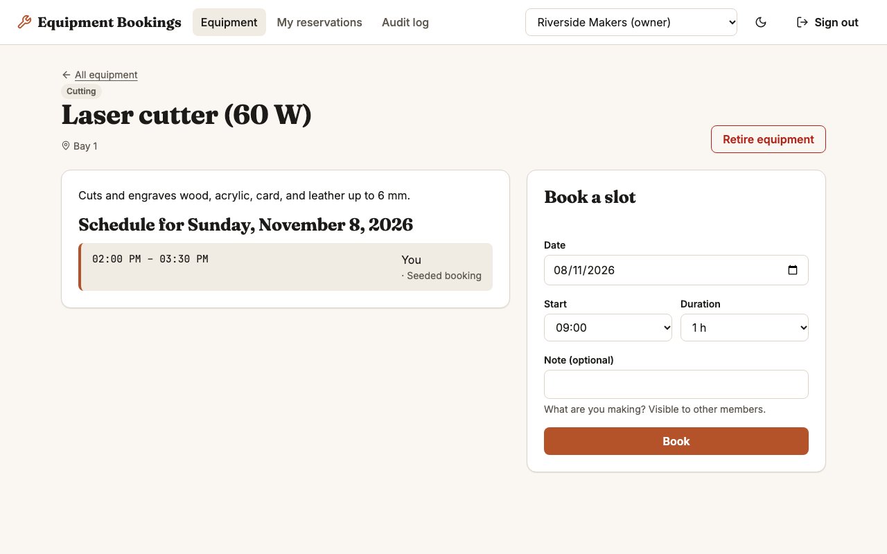
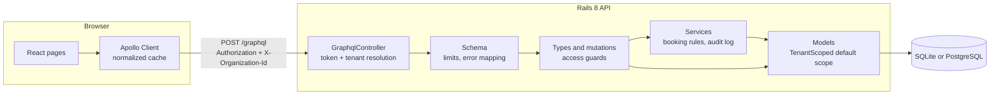

# Equipment Bookings

Equipment booking for a network of community makerspaces: members reserve tools without double bookings, and no space can ever see another space's data. Rails 8 GraphQL API with a typed React client.

[](https://github.com/Nawfaldev19/multitenant-graphql-bookings/actions/workflows/ci.yml)
[](LICENSE)



*Equipment detail page: the day's schedule next to the booking form, signed in as a space owner.*

## Why it exists

Equipment Bookings serves a fictional group of makerspaces that share one booking app. Each space has its own equipment, members, and staff, and some people belong to more than one space. That combination is where real multi-tenant products tend to fail: a forgotten filter leaks another customer's data, or two people book the same slot at the same moment. This project shows one way to make both failures structurally hard, end to end, with tests that prove it.

## Key features

- **A space's data stays inside that space.** Tenant-scoped models refuse to query without a current organization, so a forgotten filter raises instead of leaking rows. See [`TenantScoped`](server/app/models/concerns/tenant_scoped.rb) and [`tenant_isolation_test.rb`](server/test/graphql/tenant_isolation_test.rb).
- **No double bookings, even under load.** The equipment row is locked before the active and overlap checks and the insert, all in one transaction. A test fires four simultaneous requests for one slot and asserts exactly one wins; CI also runs it on PostgreSQL, where it fails if the lock is removed. Cancellation is locked the same way. See [`ReservationBooking`](server/app/services/reservation_booking.rb), [`reservation_booking_concurrency_test.rb`](server/test/services/reservation_booking_concurrency_test.rb), and [TESTING.md](docs/TESTING.md#concurrency-on-postgresql).
- **Form errors land next to the right field.** Fixable problems (overlap, past start, too long) come back as typed payload errors; auth and permission failures are coded GraphQL errors. See [ADR-003](docs/DECISIONS.md#adr-003-graphql-with-mutation-payload-errors).
- **The API resists abuse.** Per-request authorization guards, a failed-sign-in throttle, strict security headers, depth and complexity limits, capped cursor pagination, and batched loading that keeps query counts flat. See [`sign_in_throttle.rb`](server/app/services/sign_in_throttle.rb), [`equipment_bookings_schema.rb`](server/app/graphql/equipment_bookings_schema.rb), [`access_guards.rb`](server/app/graphql/access_guards.rb), and [`record_by_id.rb`](server/app/graphql/sources/record_by_id.rb).
- **Schema changes break the build, not production.** Client types are generated from the server's schema dump, and CI fails if either drifts. See [`codegen.ts`](client/codegen.ts) and [`operations.ts`](client/src/graphql/operations.ts).
- **Usable by keyboard and screen reader.** Labelled forms with ARIA-linked errors, live regions for results, loading, empty, and error states, and light and dark themes. See [`BookingForm.tsx`](client/src/features/booking/BookingForm.tsx) and [`States.tsx`](client/src/components/States.tsx).

## Quick start

Requirements: Ruby 3.3.11 (from [`server/.ruby-version`](server/.ruby-version)) with Bundler, and Node.js 20 or newer. No database server is needed; the app uses SQLite unless `DATABASE_URL` points at PostgreSQL.

```bash
git clone https://github.com/Nawfaldev19/multitenant-graphql-bookings.git
cd multitenant-graphql-bookings
bin/dev
```

[`bin/dev`](bin/dev) installs gems into `server/vendor/bundle` and npm packages into `client/node_modules`, creates and seeds the database on first run, and starts:

- the API at http://localhost:3000/graphql
- the web app at http://localhost:5173

Open the web app, click **Try the demo**, and pick a demo account. All demo accounts share the password `equipment-bookings-demo`.

| Account | Email | Role |
|---|---|---|
| Ada Okafor | ada@example.com | Owner at Riverside Makers, member at Foundry Lane Workshop |
| Ben Lindqvist | ben@example.com | Staff at Riverside Makers |
| Cora Mbeki | cora@example.com | Member at Riverside Makers |
| Theo Marsh | theo@example.com | Owner at Foundry Lane Workshop |
| Priya Raman | priya@example.com | Member at Foundry Lane Workshop |

Reset the demo data at any time with `cd server && bin/rails db:seed`. Every variable has a working local default; [`.env.example`](.env.example) lists them.

**With Docker instead:** `docker compose up --build`, then open http://localhost:5173.

## Architecture



- **Controller** authenticates the bearer token and resolves the membership for the requested space into request-scoped `Current` state.
- **Resolvers** start with an explicit guard (`require_membership!` or `require_manager!`); the model layer is the backstop if one is forgotten.
- **Services** keep pure time rules (`BookingRules`) separate from transactional writes (`ReservationBooking`, `ReservationCancellation`).
- **Client pages** own data fetching; components are presentational and typed from generated documents.

**Key trade-off:** tenant isolation lives in a fail-closed model default scope rather than in per-resolver filters, a database per tenant, or PostgreSQL row-level security. It is visible in application code and cannot be forgotten, at the cost of a "magic" default scope and a named `TenantScoped.across_tenants` block for seeds and maintenance ([ADR-001](docs/DECISIONS.md#adr-001-tenant-isolation-with-a-fail-closed-default-scope)). SQLite by default keeps setup to one command but serializes all writes ([ADR-002](docs/DECISIONS.md#adr-002-sqlite-by-default)), so the locking is tested on PostgreSQL as well ([ADR-009](docs/DECISIONS.md#adr-009-postgresql-as-a-second-test-database)).

Request flow, concurrency, and performance details: [docs/ARCHITECTURE.md](docs/ARCHITECTURE.md).

## Tech stack

| Choice | Why |
|---|---|
| Ruby on Rails 8 (API mode) | Mature conventions for models, validations, and transactions; API mode drops the view layer. |
| graphql-ruby | The standard Ruby GraphQL server, with built-in dataloader, connections, and query analysis. |
| SQLite (default), PostgreSQL (optional) | SQLite means zero setup for reviewers; Rails 8 runs its transactions in `IMMEDIATE` mode, which serializes writers. PostgreSQL, through `DATABASE_URL`, is where the row locks are tested. |
| bcrypt + signed tokens | `has_secure_password` for passwords; `ActiveSupport::MessageVerifier` for expiring bearer tokens without a token table ([ADR-004](docs/DECISIONS.md#adr-004-signed-expiring-bearer-tokens)). |
| React 18 + TypeScript (strict) | Strict null checks catch whole classes of UI bugs at compile time. |
| Apollo Client 3 | Normalized cache, pagination helpers, and a link chain for auth headers and error handling. |
| GraphQL Code Generator | Every query result and variable is checked against the schema ([ADR-007](docs/DECISIONS.md#adr-007-generated-client-types-committed-to-the-repository)). |
| Vite | Fast dev server and a small production build. |
| Minitest, Vitest, Testing Library, Playwright | One fast runner per layer; Playwright for real browser flows. |
| RuboCop, ESLint, Prettier | Lint on both sides; Prettier (120 columns) formats the client so reviews are about content, not layout. |
| Lucide icons | Consistent, permissively licensed (ISC) icon set. |

## Testing and quality

| Suite | Count | Line coverage |
|---|---|---|
| Rails (Minitest): models, services, concurrency, GraphQL integration | 98 tests | 98% |
| Client (Vitest + Testing Library): logic, components, pages | 71 tests | 97% |
| End to end (Playwright): booking flows and direct API attacks | 4 tests | n/a |

Coverage thresholds are enforced on both sides. [CI](.github/workflows/ci.yml) runs RuboCop, a schema-drift check, and the Rails tests on SQLite; the Rails tests again on PostgreSQL 16; codegen drift, a Prettier check, ESLint, type checking, Vitest with coverage, and the production build; then the Playwright suite.

```bash
# server
cd server
bundle exec rubocop
bin/rails test                    # writes a coverage report to server/coverage/
# optional: the same suite on PostgreSQL, see docs/TESTING.md

# client
cd client
npm run format:check              # or `npm run format` to fix
npm run lint
npm run typecheck
npm run test:coverage
npm run build
npx playwright install chromium   # once
npm run test:e2e                  # starts both apps against a separate e2e database
```

Strategy, the full list of tenant isolation checks, and known gaps: [docs/TESTING.md](docs/TESTING.md).

## Decisions and further docs

- [Decision records](docs/DECISIONS.md): nine ADRs, from tenant isolation and SQLite to offset-backed cursors and testing locks on PostgreSQL
- [Architecture](docs/ARCHITECTURE.md): components, request flow, tenancy model, concurrency, performance
- [Security](docs/SECURITY.md): threat model and mitigations
- [Testing](docs/TESTING.md): strategy, coverage, and known gaps
- [Plan](docs/PLAN.md): goal, scope, and the order we built it in
- [References](docs/REFERENCES.md): specifications and sources for the patterns used
- [Changelog](CHANGELOG.md) and [third-party notices](THIRD_PARTY_NOTICES.md)

## Known limitations and next steps

This is a portfolio demo, not a product.

- **No sign-up, invitations, or password reset.** Users and memberships come from the seed file.
- **Times display in the browser's time zone.** Spaces have no time zone of their own. Next: a per-organization time zone.
- **Bearer tokens live in `localStorage`** and cannot be revoked before they expire (12 hours). Next: an `HttpOnly` cookie or a server-side session table ([SECURITY.md](docs/SECURITY.md)).
- **Sign-in throttling is per process.** Failed attempts are counted in memory, so the limit resets on restart and is not shared across processes. Next: a shared cache store ([SECURITY.md](docs/SECURITY.md)).
- **Cursor pagination is offset-based** under the hood. Fine at this scale; keyset pagination is the fix for large tables ([ADR-005](docs/DECISIONS.md#adr-005-offset-backed-cursors)).
- **By default all writes are serialized by SQLite.** On PostgreSQL the same code takes per-row locks instead, and CI tests that. Next: row-level security under the default scope.
- **No real-time updates.** Another member's booking appears after a refresh or the next query.
- **The Docker setup runs in development mode** and has not been tested on the machine this was built on.

## Project status

Complete as a portfolio demo (v1.1.0, see the [changelog](CHANGELOG.md)). Not deployed; there is no hosted demo, so run it locally with the quick start above.

<details>
<summary>Recapturing the screenshot</summary>

Run `bin/dev`, open http://localhost:5173, click **Try the demo**, then **Continue as Ada Okafor**. Open **Laser cutter (60 W)**. Set the browser window to 1280 x 800, take a screenshot, and save it as `docs/screenshot.png`.

</details>

## Author

Nawfal Imran · [GitHub](https://github.com/Nawfaldev19) · [LinkedIn](https://www.linkedin.com/in/nawfal-imran-886b13218)

## License

[MIT](LICENSE). Third-party licenses are listed in [THIRD_PARTY_NOTICES.md](THIRD_PARTY_NOTICES.md). All people, places, and data in the demo are fictional.
