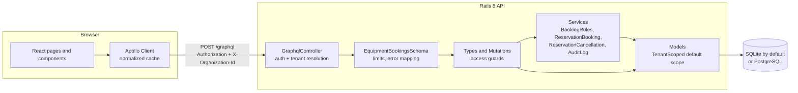
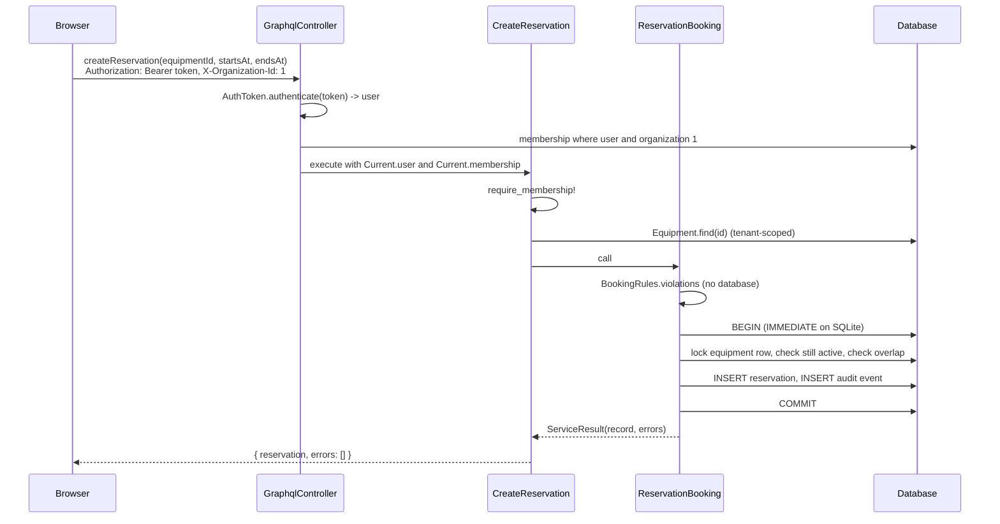
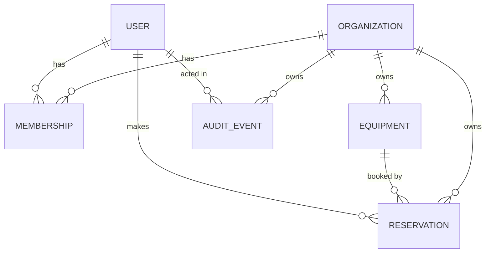

# Architecture

This document explains how the pieces fit together, how a request moves through the system, how tenant isolation works, and where performance was considered.

**Terms used here**

- **Organization (tenant):** one makerspace. Every piece of equipment, reservation, and audit event belongs to exactly one.
- **Membership:** the link between a user and an organization, carrying a role: `owner`, `staff`, or `member`. "Manager" means owner or staff.
- **Current:** Rails' request-scoped storage (`ActiveSupport::CurrentAttributes`). It holds the request id, the signed-in user, and the active membership for one request, and is reset automatically afterwards.

## Components

| Layer | Folder | Responsibility |
|---|---|---|
| Controller | `server/app/controllers` | Parse the request, authenticate the bearer token, resolve the membership for the requested organization, log one structured line per operation. |
| Schema | `server/app/graphql/equipment_bookings_schema.rb` | Depth, complexity, and page-size limits; map `RecordNotFound` and missing-tenant errors to coded GraphQL errors. |
| Types and mutations | `server/app/graphql/types`, `server/app/graphql/mutations` | Shape of the API. Every tenant field starts with a guard (`require_membership!` or `require_manager!`). |
| Services | `server/app/services` | Business rules and multi-step writes. Pure rules (`BookingRules`) are separate from transactional work (`ReservationBooking`). |
| Models | `server/app/models` | Validations, associations, scopes, and the tenant default scope. |
| Client data | `client/src/graphql`, `client/src/lib` | Typed operations (generated), Apollo setup, session, time and error helpers. |
| Client UI | `client/src/pages`, `client/src/components`, `client/src/features` | Pages own data fetching; components are presentational; `features/booking` holds the booking form. |

## Request flow: creating a reservation

Validation problems the user can fix (overlap, past start time, too long) come back in the mutation's `errors` list with a `field` name, so the form can show them next to the right input. Problems the user cannot fix by editing the form (not signed in, wrong role, unknown id) are top-level GraphQL errors with an `extensions.code`.

## Tenancy model

Users are global (one login across spaces). Everything else is owned by one organization and carries an `organization_id`.

Isolation is enforced in three places, from strongest to weakest:

1. **Model layer (`TenantScoped`).** Equipment, Reservation, and AuditEvent include a concern whose default scope filters by `Current.organization`. If no organization is set, any query raises `MissingTenantError` instead of returning every tenant's rows. This "fail closed" rule means a forgotten guard in a new resolver produces an error, not a data leak. The concern also assigns new records to the current tenant and refuses to save a record into another one. Cross-tenant work (seeding) must opt in explicitly with `TenantScoped.across_tenants { ... }`.
2. **Request layer (`GraphqlController`).** The `X-Organization-Id` header is only a *selection*. The controller looks up the membership through the signed-in user's own memberships, so a forged header yields no tenant at all.
3. **API layer (guards and error mapping).** Resolvers call `require_membership!` or `require_manager!` before touching data. A record from another tenant is invisible to the default scope, so it surfaces as `NOT_FOUND`, which avoids confirming that the id exists elsewhere.

The client resets its Apollo cache when the user switches organization, so no cached data from one space is ever shown in another.

### Why a default scope?

Default scopes are often discouraged because they surprise people. Here the surprise is the point: the safe behavior is automatic, and the unsafe behavior (reading across tenants) needs a named, greppable block. Alternatives considered are in [ADR-001](DECISIONS.md#adr-001-tenant-isolation-with-a-fail-closed-default-scope).

## Concurrency

Two people clicking "Book" for the same slot at the same moment is the classic race: both check, both see the slot free, both insert. The rule we follow is: take the row lock first, then read everything the write depends on.

- **Booking.** `ReservationBooking` locks the equipment row, then checks that the item is still active and that the slot is free, then inserts. Because the active check comes after the lock, a booking cannot land on an item that a concurrent `retireEquipment` has just retired. `retireEquipment` takes the same lock.
- **Cancelling.** `ReservationCancellation` locks the reservation row and re-reads its state. When two cancellations race, the second waits, sees the first one's change, and reports "already cancelled", so only one update and one audit event are written.

How the lock behaves depends on the database:

- On **PostgreSQL** (`DATABASE_URL`), `lock!` issues `SELECT ... FOR UPDATE`, which serializes work per row while leaving other items unblocked.
- On **SQLite** (the default), Rails 8 opens transactions with `BEGIN IMMEDIATE`, which takes the database write lock at the start of the transaction. Every writer is serialized, so the row lock adds nothing beyond a fresh read of the row.

Only PostgreSQL can show that the locks are needed, so CI runs the server suite on both. [TESTING.md](TESTING.md#concurrency-on-postgresql) records what happens when a lock is removed.

A database check constraint (`ends_at > starts_at`) backs up the application rule.

## Performance

| Concern | What the code does | Why |
|---|---|---|
| N+1 queries in lists | `Reservation.equipment`, `Reservation.member`, and `AuditEvent.actor` resolve through `Sources::RecordById`, a GraphQL dataloader source that batches ids into one query per model. | A page of 50 reservations costs a fixed number of queries. A test asserts the count stays bounded. |
| Unbounded lists | All lists are Relay connections with a default page size of 20 and a hard cap of 50. The schedule field only accepts windows of 7 days or less. | Prevents a single request from loading an entire table. |
| Expensive queries | `max_depth 12` and `max_complexity 1000`. | Rejects abusive nesting and huge page requests before execution. The budget is sized so the richest list the client renders fits (tested). |
| Indexes | `reservations(equipment_id, status, starts_at)` for overlap checks; `(organization_id, user_id, starts_at)` for "my reservations"; `audit_events(organization_id, created_at)`. | Each hot query has a matching index. |
| Client re-renders | Session context value is memoized; search input is debounced (250 ms) before it changes query variables. | Typing does not fire a request per keystroke. |
| Bundle size | One production bundle of about 117 kB gzipped (React, Apollo, router, icons). | Acceptable for a demo; code splitting by route would be the next step. |

## Logging

Logs are one JSON object per line ([`JsonLogFormatter`](../server/lib/json_log_formatter.rb)), each with the request id. Every GraphQL request logs its operation name, user id, organization id, error count, and duration. Passwords and tokens are filtered from parameter logs.

## Design system

The client uses CSS custom properties defined in [`tokens.css`](../client/src/styles/tokens.css):

- **Type:** Fraunces for headings, Inter for body text, JetBrains Mono for times and identifiers. A 1.25 type scale (`--text-xs` to `--text-3xl`).
- **Color:** warm neutral "paper" and "graphite" backgrounds with a copper accent. Every pair used for text meets WCAG AA contrast in both themes. The focus ring uses a separate blue so focus is never confused with the accent.
- **Spacing, radius, shadow, motion:** a 4 px spacing scale, three radii, two elevations, and two durations that drop to zero under `prefers-reduced-motion`.
- **Themes:** `data-theme="light|dark"` on `<html>`, defaulting to the operating system preference and remembered per browser.
